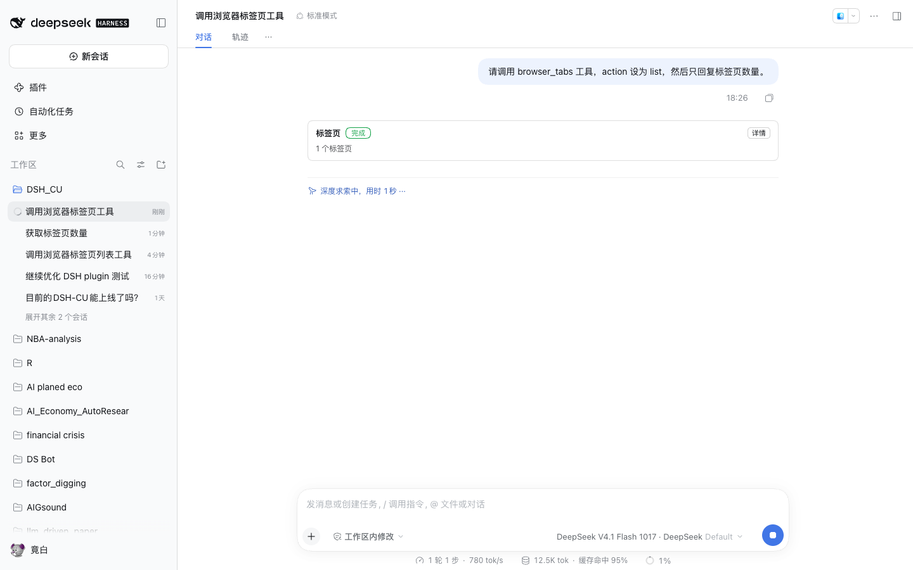

# @dsh-cu/client

The browser half of DSH-CU: it renders every DSH-CU tool result as a card in the
DSH client transcript instead of raw JSON.

## How DSH finds it

The package is a normal Loader entry (`index.js` has a no-op `apply`) that also
declares:

```json
"dsh": { "client": { "platform": "web", "inject": [] } },
"exports": { "./client": "./lib/client.js" }
```

`@deepseek-ai/dsh-client-modules` scans enabled entries for `dsh.client`,
composes them into the boot graph, and serves the bundle at
`/plugins/<entry id>/<file>?rev=…`. The module itself is plain
`window.__ModuleLoader__.load({ id, factory })` JavaScript using the baseline
`react` and `react/jsx-runtime`, so there is no bundler step.

## What the cards show

`ctx.slots.register({ name: 'tool.call.toolview', key: '<tool name>', id }, Card)`
for every tool the providers register. Each card carries:

- the tool label and a status chip mapped from the result's `status` field
- the route (`本地决策` / `已验证技能` / `人工`) when present
- a one-line summary: element count and URL, tab count and action, extracted
  field names, uploaded or downloaded file names, or the failure `reason`
- an expandable pretty-printed payload

The card treats the payload as data: it never executes or follows anything the
page or the tool returned.



Labels are Simplified Chinese for now; the card does not yet hook the client
locale service, so an English UI still shows the Chinese tool labels.

## Verify

```bash
npm test --workspace @dsh-cu/client            # registration + rendering, no browser
node scripts/web-card-smoke.mjs <dsh-web-url>  # real dsh web session, asserts the card
```

The smoke script boots nothing by itself: start a web profile that mounts
`@dsh-cu/bundle` (`dsh --profile dsh-cu --no-open --port 0` with the web-app
bundle) and pass the printed URL.
